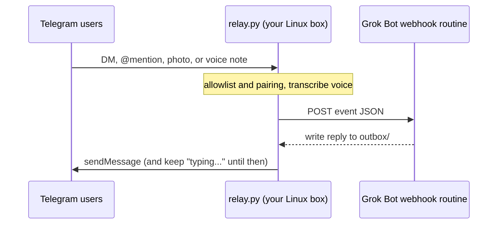

# Grok Bot Telegram bridge

This bridge turns your [Grok Bot](https://cursor.com/help/grok-bot) into a
**multiplayer agent**. Add it to a Telegram DM or a group chat and it talks with
other people — family, teammates, whoever you invite — in the place you already
chat. Access is gated by pairing codes: only people you approve can reach the
bot.

It is a small, self-hosted relay: one Python file using only the standard
library, plus an optional local speech-to-text helper for voice notes. It needs
no inbound ports, no public server, and no database.

> **Status:** early and small. It works well for one household, but it has not
> been hardened for public bots. Read [SECURITY.md](SECURITY.md) before you
> connect it to a bot that has access to your email, money, or work.

## How it works

## Features

- **Multiplayer DMs and groups.** One Grok Bot, many people. Anyone you approve
  can talk to it in a private chat or in a shared group.
- **Mention or reply in groups.** The bridge forwards a group message only when
  someone @mentions the bot or replies to it, and only if that person is
  allowlisted.
- **Allowlist and pairing codes.** Strangers get a short code, not access. You
  approve them on the machine or with `/approve` in Telegram.
- **Photos.** Downloaded to disk so the bot can look at the image.
- **Voice notes.** Transcribed locally with faster-whisper; the bot sees the
  transcript.
- **Persistent typing indicator.** Telegram's "typing..." refreshes until the
  reply is sent, or until a configurable cap (default 180s).
- **Auto-restart.** A watchdog restarts the relay if it crashes. `ensure.sh`
  brings it back after a reboot (cron, a systemd timer, or a scheduled Grok Bot
  routine).
- **Proactive messages.** Any routine on the same bot can post to a chat by
  writing a file to `outbox/`.

## Quick start

You need a persistent Linux machine the Grok Bot can also read and write files
on, Python 3.10+, and `ffmpeg` if you want voice notes. Full detail is in
[docs/SETUP.md](docs/SETUP.md).

1. **Create a Telegram bot** with [@BotFather](https://t.me/BotFather). Copy the
   token. For groups, send `/setprivacy`, pick this bot, choose **Disable**, then
   remove the bot from the group and add it again.
2. **Create a webhook routine** on the Grok Bot that should answer. Start from
   [examples/routine-prompt.md](examples/routine-prompt.md). Copy the webhook URL
   and key from the **Grok Bot desktop app**: bot → Details → Routines → your
   routine → Webhook. The mobile app does not show them.
3. **Configure.** `git clone` this repo, `cp .env.example .env`, `chmod 600 .env`,
   and fill in `TELEGRAM_BOT_TOKEN`, `GROKBOT_WEBHOOK_URL`, and
   `GROKBOT_WEBHOOK_KEY`. See [.env.example](.env.example) for the rest. For
   voice notes: `sudo apt install ffmpeg`, then
   `python3 -m venv .venv-asr && .venv-asr/bin/pip install -r requirements-asr.txt`.
4. **Start.** `python3 relay.py --check` then `./start.sh`. Logs go to
   `relay.log`. `./stop.sh` stops it. On systemd, use
   [examples/grokbot-telegram-bridge.service](examples/grokbot-telegram-bridge.service)
   instead. On a host without systemd, run
   [examples/keepalive-routine.md](examples/keepalive-routine.md) so the bridge
   comes back after a reboot.
5. **Pair people.** Message the bot; if you are not on the allowlist it replies
   with a pairing code. Approve with `python3 approve.py <CODE>`, or set your
   user id in `GROKBOT_ALLOWLIST` to bootstrap. `/whoami` prints your user id
   and the chat id.

## Security

This is a private bridge, not a public bot. Anyone on the allowlist can start
runs of your Grok Bot, with that bot's connectors and tools. Use a dedicated
bot with only the access it needs, keep the allowlist short, and treat the
Telegram token and webhook key like passwords. Details, including how to report
a vulnerability, are in [SECURITY.md](SECURITY.md).

## Docs

- [docs/SETUP.md](docs/SETUP.md): full setup, configuration, how it runs, and limitations
- [SECURITY.md](SECURITY.md): threat model and vulnerability reporting
- [docs/HOW-WE-BUILT-IT.md](docs/HOW-WE-BUILT-IT.md): the build story and the bugs we hit
- [examples/](examples/): routine prompt, systemd unit, and a keep-alive routine

## License

MIT. See [LICENSE](LICENSE).

This is a community project, not an official Grok Bot or Telegram product.
