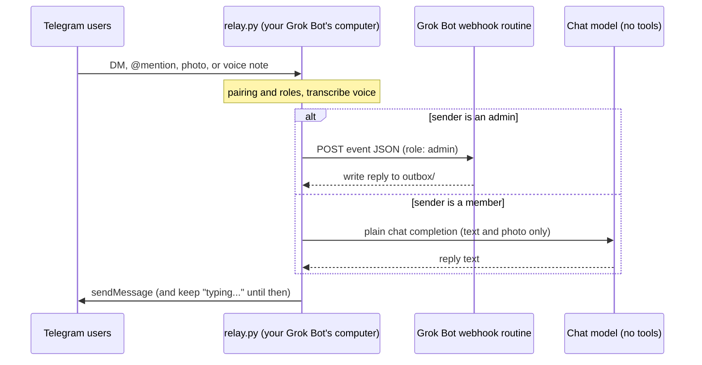

# Grok Bot Telegram bridge

This bridge turns your [Grok Bot](https://cursor.com/help/grok-bot) into a
**multiplayer agent**. Add it to a Telegram DM or a group chat and it talks with
other people — family, teammates, whoever you invite — in the place you already
chat. Access is gated by pairing codes: only people you approve can reach the
bot. **Admins** drive the full agent; **members** can chat but can never touch
the agent's tools or the machine it runs on.

**It runs on your Grok Bot's own always-on Linux computer.** Ask your Grok Bot
to set it up and start it there. Nothing needs to run on your laptop or phone,
and you don't host this on Vercel, Cloudflare, a VPS, or similar. The relay only
makes outbound connections (it long-polls Telegram and POSTs to your bot's
webhook), so there are no inbound ports, tunnels, or Tailscale.

It is a small relay: one Python file using only the standard library, plus an
optional local speech-to-text helper for voice notes. There is no database.

**Fastest setup:** paste [SETUP-PROMPT.md](SETUP-PROMPT.md) into your existing
Grok Bot (your chief-of-staff bot is fine). That bot creates a new dedicated
bot for the bridge and tells you to switch to it. The new bot then walks you
through every step.

### If you're a Grok Bot reading this

This repo is usually read by someone's existing Grok Bot, often a
chief-of-staff bot, not by a human. If that's you: don't install the bridge on
yourself. Create a **new dedicated Grok Bot** to own it, give that bot the
build brief in [SETUP-PROMPT.md](SETUP-PROMPT.md), and tell the human to open
the new bot's chat and continue there. The new bot walks them through Telegram,
secrets, and startup on this always-on Linux computer. Do not run anything on
the human's laptop or phone, and do not deploy this to Vercel, Cloudflare, a
VPS, or similar. Ask for every token and key through a hidden secret-request
field, never in chat.

> **Status:** early and small. It works well for one household, but it has not
> been hardened for public bots. Read [SECURITY.md](SECURITY.md) before you
> connect it to a bot that has access to your email, money, or work.

## How it works

## Features

- **Multiplayer DMs and groups.** One Grok Bot, many people. Anyone you approve
  can talk to it in a private chat or in a shared group.
- **Mention or reply in groups.** The bridge answers a group message only when
  someone @mentions the bot or replies to it, and only if that person is
  approved.
- **Allowlist and pairing codes.** Strangers get a short code, not access. You
  approve them on the machine or with `/approve` in Telegram.
- **Admin and member roles, with a hard boundary.** See [Roles](#roles) below.
- **Photos.** Downloaded to disk so the bot can look at the image.
- **Voice notes.** Transcribed locally with faster-whisper; the bot sees the
  transcript.
- **Persistent typing indicator.** Telegram's "typing..." refreshes until the
  reply is sent, or until a configurable cap (default 180s).
- **Auto-restart.** A watchdog restarts the relay if it crashes. On the Grok Bot
  computer, a scheduled keep-alive routine runs `ensure.sh` after a reboot.
- **Proactive messages.** Any routine on the same bot can post to a chat by
  writing a file to `outbox/`.

## Roles

The person who hosts the bot sets the first admin — put your Telegram user id in
`GROKBOT_ADMINS` when you configure it, or approve your own pairing code with
`python3 approve.py <CODE> --admin`. The first person to message the bot is
**not** made an admin automatically. Everyone else is approved as a **member**.
You can change a role later.

| | Admin | Member (the default) |
|---|---|---|
| Chat (text, photos, voice notes) and get a reply | yes, via the full Grok Bot | yes, via a plain no-tools model call |
| Tools, the host computer, files, processes, routines, settings | whatever the bot can do | **no** |
| `/approve`, `/promote`, `/demote` | yes | no |
| `/whoami` | yes | yes |

Members can never reach the Grok Bot webhook. Their messages stay on a chat-only
path: the relay answers them itself with a plain chat-completion call that has
no tools, no function calling, and no file or shell access.

### Approving people from Telegram

Commands go to the bridge, not to the Grok Bot, and only an admin can use them.

- **In a DM** with the bot: `/approve CODE`
- **In a group:** `/approve@BotName CODE`, or reply to one of the bot's messages
  with `/approve CODE`. A plain `/approve CODE` in a group (not addressed to the
  bot) is ignored.
- The same addressing rules apply to `/promote <user_id>`, `/demote <user_id>`,
  and `/whoami`.
- `/approve` always adds the person as a member. An admin can then
  `/promote <user_id>` or `/demote <user_id>`. The last admin can't be demoted.

## Quick start

The usual path is to ask your Grok Bot to do this on its own computer: clone the
repo, fill in `.env`, and run `./start.sh`. You need Python 3.10+ on that
machine, and `ffmpeg` if you want voice notes. Full detail is in
[docs/SETUP.md](docs/SETUP.md).

1. **Create a Telegram bot** with [@BotFather](https://t.me/BotFather). Copy the
   token. For groups, send `/setprivacy`, pick this bot, choose **Disable**, then
   remove the bot from the group and add it again.
2. **Create a webhook routine** on the Grok Bot that should answer. Start from
   [examples/routine-prompt.md](examples/routine-prompt.md). Copy the webhook URL
   and key from the **Grok Bot desktop app**: bot → Details → Routines → your
   routine → Webhook. The mobile app does not show them.
3. **Configure.** `git clone` this repo, `cp .env.example .env`, `chmod 600 .env`,
   and fill in `TELEGRAM_BOT_TOKEN`, `GROKBOT_WEBHOOK_URL`, and
   `GROKBOT_WEBHOOK_KEY`. Put your own Telegram user id in `GROKBOT_ADMINS`
   (that is how the first admin is set). For member chat, set
   `GROKBOT_MEMBER_LLM_API_KEY` (an xAI API key by default; any OpenAI-compatible
   endpoint works). See [.env.example](.env.example) for the rest. For voice
   notes: `sudo apt install ffmpeg`, then
   `python3 -m venv .venv-asr && .venv-asr/bin/pip install -r requirements-asr.txt`.
4. **Start.** `python3 relay.py --check` then `./start.sh`. Logs go to
   `relay.log`. `./stop.sh` stops it. After a reboot, a scheduled Grok Bot
   routine can run [examples/keepalive-routine.md](examples/keepalive-routine.md)
   so the bridge comes back.
5. **Pair people.** Message the bot; if you are not approved yet it replies
   with a pairing code. Approve with `python3 approve.py <CODE>` (member, the
   default) or, as an admin, `/approve CODE` in Telegram. `/whoami` prints your
   user id, the chat id, and your role.

Optional: if you self-host the relay on some other Linux machine that has
systemd, there is an example unit at
[examples/grokbot-telegram-bridge.service](examples/grokbot-telegram-bridge.service).
The intended setup on your Grok Bot's computer does not need it.

## Security

This is a private bridge, not a public bot. Admins can start runs of your Grok
Bot, with that bot's connectors and tools, so make only people you fully trust
admins. Members never reach the bot: their messages go only to a no-tools chat
model (and so leave the machine for that model's API). Use a dedicated bot with
only the access it needs, keep the admin list short, and treat the Telegram
token, webhook key, and member LLM key like passwords. Details, including how to report
a vulnerability, are in [SECURITY.md](SECURITY.md).

## Docs

- [SETUP-PROMPT.md](SETUP-PROMPT.md): copy-paste prompt for your existing Grok Bot to start setup
- [docs/SETUP.md](docs/SETUP.md): full setup, configuration, how it runs, and limitations
- [SECURITY.md](SECURITY.md): threat model and vulnerability reporting
- [docs/HOW-WE-BUILT-IT.md](docs/HOW-WE-BUILT-IT.md): the build story and the bugs we hit
- [examples/](examples/): routine prompt, keep-alive routine, and an optional systemd unit for self-hosting elsewhere

## License

MIT. See [LICENSE](LICENSE).

This is a community project, not an official Grok Bot or Telegram product.
