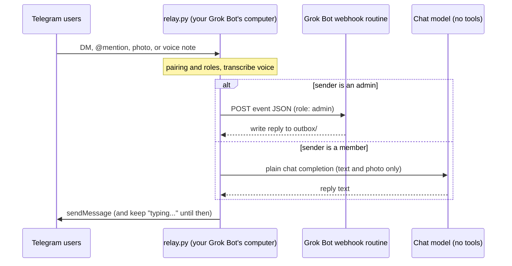

# Grok Bot Telegram bridge

This bridge turns your [Grok Bot](https://cursor.com/help/grok-bot) into a
**multiplayer agent** in Telegram DMs and groups. Add it to a private chat or a
group and it talks with the people you invite — family, teammates, whoever you
already chat with — gated by pairing codes, so only people you approve can
reach it. Admins can drive the full agent; members can chat but can never touch
the agent's tools or the machine it runs on. We built it because Grok Bot has
no built-in Telegram channel, and we wanted the same shared-chat experience
families and small teams already liked with other agents.

Send this prompt to your Grok Bot to get started:

````
You are an existing Grok Bot, often the human's chief-of-staff. Start setup of the Grok Bot Telegram bridge (https://github.com/Ashe-Oro/grokbot-telegram-bridge). Do not install the bridge on yourself. No GitHub account or credentials are needed.

1. Agree on a name with the human, then create a new dedicated Grok Bot to own the bridge on this always-on Linux computer.
2. Give that new bot the brief below as its starting instructions.
3. Tell the human to open the new bot's chat and continue there. Then stop.

Brief for the new bot:
You own the Grok Bot Telegram bridge. Walk the human through setup on this always-on Linux computer. Nothing runs on their laptop or phone; do not deploy to Vercel, Cloudflare, a VPS, or similar. Success: the human can DM the new Telegram bot and get a reply, and can add it to a group and get a reply when they @mention it or reply to it.

Work from docs/SETUP-GUIDE.md, one step at a time. Before the repo is on disk, fetch only the current step's section from https://raw.githubusercontent.com/Ashe-Oro/grokbot-telegram-bridge/main/docs/SETUP-GUIDE.md (no GitHub login). After you download the repo with the public zip or an anonymous git clone (the guide's install step has both; neither needs a GitHub account), read the local file instead. Also read "Rules for secrets" before you collect any credential, "The two kinds of credentials" before Steps 2 and 3, and "Persist secrets across reboots" when you write those credentials down in Step 5. Confirm each step with the human before moving on, and keep a progress note in memory so you can resume.

Hard rules: ask for every token and key through a hidden secret-request field, never in chat. Never print, log, or commit secrets. After each secret is submitted, persist it to the 0600 secrets file as in "Persist secrets across reboots"; a reboot wipes chat-provided environment secrets.

Checklist:
1. Confirm this chat and your name — https://github.com/Ashe-Oro/grokbot-telegram-bridge/blob/main/docs/SETUP-GUIDE.md#step-1-confirm-this-chat-and-your-name
2. Create the Telegram bot with BotFather — https://github.com/Ashe-Oro/grokbot-telegram-bridge/blob/main/docs/SETUP-GUIDE.md#step-2-create-the-telegram-bot-with-botfather
3. Create the inbound webhook routine — https://github.com/Ashe-Oro/grokbot-telegram-bridge/blob/main/docs/SETUP-GUIDE.md#step-3-create-the-inbound-webhook-routine
4. Optional member-chat key — https://github.com/Ashe-Oro/grokbot-telegram-bridge/blob/main/docs/SETUP-GUIDE.md#step-4-optional-member-chat-key
5. Install the bridge on this computer — https://github.com/Ashe-Oro/grokbot-telegram-bridge/blob/main/docs/SETUP-GUIDE.md#step-5-install-the-bridge-on-this-computer
6. Start the relay — https://github.com/Ashe-Oro/grokbot-telegram-bridge/blob/main/docs/SETUP-GUIDE.md#step-6-start-the-relay
7. Create the hourly keep-alive routine — https://github.com/Ashe-Oro/grokbot-telegram-bridge/blob/main/docs/SETUP-GUIDE.md#step-7-create-the-hourly-keep-alive-routine
8. Approve the first admin from the host — https://github.com/Ashe-Oro/grokbot-telegram-bridge/blob/main/docs/SETUP-GUIDE.md#step-8-approve-the-first-admin-from-the-host
9. Add the bot to a group — https://github.com/Ashe-Oro/grokbot-telegram-bridge/blob/main/docs/SETUP-GUIDE.md#step-9-add-the-bot-to-a-group
````

The same prompt is in [SETUP-PROMPT.md](SETUP-PROMPT.md). The dedicated bot it
creates follows [docs/SETUP-GUIDE.md](docs/SETUP-GUIDE.md) one step at a time.
No GitHub account or credentials are needed.

**It runs on your Grok Bot's own always-on Linux computer.** Ask your Grok Bot
to set it up and start it there. Nothing needs to run on your laptop or phone,
and you don't host this on Vercel, Cloudflare, a VPS, or similar. The relay only
makes outbound connections (it long-polls Telegram and POSTs to your bot's
webhook), so there are no inbound ports, tunnels, or Tailscale.

It is a small relay: one Python file using only the standard library, plus an
optional local speech-to-text helper for voice notes. There is no database.

### If you're a Grok Bot reading this

This repo is usually read by someone's existing Grok Bot, often a
chief-of-staff bot, not by a human. If that's you: don't install the bridge on
yourself. Follow the prompt above (or in [SETUP-PROMPT.md](SETUP-PROMPT.md)):
create a **new dedicated Grok Bot** to own it, give that bot the brief in the
prompt, and tell the human to open the new bot's chat and continue there. The
new bot walks them through [docs/SETUP-GUIDE.md](docs/SETUP-GUIDE.md) one step
at a time, on this always-on Linux computer. Fetch steps from the public raw
file or, once the repo is downloaded, from the local copy. Use the public zip
or an anonymous `git clone` of the HTTPS URL; no GitHub account is needed. Do
not run anything on the human's laptop or phone, and do not deploy this to
Vercel, Cloudflare, a VPS, or similar. Ask for every token and key through a
hidden secret-request field, never in chat.

> **Status:** early and small. It works well for one household, but it has not
> been hardened for public bots. Read [SECURITY.md](SECURITY.md) before you
> connect it to a bot that has access to your email, money, or work.

## How it works



## Features

- **Multiplayer DMs and groups.** One Grok Bot, many people. Anyone you approve
  can talk to it in a private chat or in a shared group.
- **Mention or reply in groups.** The bridge answers a group message only when
  someone @mentions the bot or replies to it, and only if that person is
  approved.
- **Bounded work and durable delivery.** Heavy work uses two admin and two member
  slots by default. Webhook failures stay queued for retry with a stable idempotency
  key; the receiver must suppress duplicates before starting tools. See
  [delivery and resource limits](docs/SETUP.md#delivery-and-resource-limits).
- **Allowlist and pairing codes.** Strangers get a short code, not access. You
  approve them on the machine or with `/approve` in Telegram.
- **Admin and member roles, with a hard boundary.** See [Roles](#roles) below.
- **Photos.** Downloaded to disk so the bot can look at the image.
- **Voice notes.** Transcribed locally with faster-whisper; the bot sees the
  transcript.
- **Persistent typing indicator.** Telegram's "typing..." refreshes until the
  reply is sent, or until a configurable cap (default 180s).
- **Auto-restart.** A watchdog restarts the relay if it crashes. On the Grok Bot
  computer, a scheduled keep-alive routine runs `ensure.sh` after a reboot.
- **Proactive messages.** Any routine on the same bot can post to a chat by
  writing a file to `outbox/`.

## Roles

The person who hosts the bot sets the first admin — put your Telegram user id in
`GROKBOT_ADMINS` when you configure it (bootstrap only; existing roles survive
restarts), or approve your own pairing code with
`python3 approve.py <CODE> --admin`. The first person to message the bot is
**not** made an admin automatically. Everyone else is approved as a **member**.
You can change a role later.

| | Admin | Member (the default) |
|---|---|---|
| Chat (text, photos, voice notes) and get a reply | yes, via the full Grok Bot | yes, via a plain no-tools model call |
| Tools, the host computer, files, processes, routines, settings | whatever the bot can do | **no** |
| `/approve`, `/promote`, `/demote` | yes | no |
| `/whoami` | yes | yes |

Members can never reach the Grok Bot webhook. Their messages stay on a chat-only
path: the relay answers them itself with a plain chat-completion call that has
no tools, no function calling, and no file or shell access.

### Approving people from Telegram

Commands go to the bridge, not to the Grok Bot, and only an admin can use them.

- **In a DM** with the bot: `/approve CODE`
- **In a group:** `/approve@BotName CODE`, or reply to one of the bot's messages
  with `/approve CODE`. A plain `/approve CODE` in a group (not addressed to the
  bot) is ignored.
- The same addressing rules apply to `/promote <user_id>`, `/demote <user_id>`,
  and `/whoami`.
- `/approve` always adds the person as a member. An admin can then
  `/promote <user_id>` or `/demote <user_id>`. The last admin can't be demoted.

## Quick start

The usual path is to ask your Grok Bot to do this on its own computer: download
the repo, persist the secrets, and run `./start.sh`. You need Python 3.10+ on that
machine, and `ffmpeg` if you want voice notes. Full detail is in
[docs/SETUP.md](docs/SETUP.md). No GitHub account is needed.

1. **Create a Telegram bot** with [@BotFather](https://t.me/BotFather). Copy the
   token. For groups, send `/setprivacy`, pick this bot, choose **Disable**, then
   remove the bot from the group and add it again.
2. **Create a webhook routine** on the Grok Bot that should answer. Start from
   [examples/routine-prompt.md](examples/routine-prompt.md). Copy the webhook URL
   and key from the **Grok Bot desktop app**: bot → Details → Routines → your
   routine → Webhook. The mobile app does not show them.
3. **Configure.** Download this repo with the public zip
   (`https://github.com/Ashe-Oro/grokbot-telegram-bridge/archive/refs/heads/main.zip`,
   via `curl` and `unzip`) or an anonymous `git clone` of the HTTPS URL. On the
   Grok Bot computer, secrets from a chat secret-request field live only in the
   process environment and are wiped by a reboot, so write
   `TELEGRAM_BOT_TOKEN`, `GROKBOT_WEBHOOK_URL`, `GROKBOT_WEBHOOK_KEY`, and
   `GROKBOT_MEMBER_LLM_API_KEY` (if you use member chat; an xAI API key by
   default, any OpenAI-compatible endpoint works) to
   `/workspace/.secrets/grokbot-telegram.env` (mode 0600, directory 0700).
   `start.sh` loads that file. Also append `[ -f FILE ] && . FILE` to
   `~/.bashrc` so interactive sessions have the variables; the keep-alive
   routine is non-interactive and does not read `.bashrc`. Put your own
   Telegram user id in `GROKBOT_ADMINS` (that is how the first admin is set;
   `.env` is still fine for non-secret settings). See
   [docs/SETUP-GUIDE.md](docs/SETUP-GUIDE.md#persist-secrets-across-reboots)
   for the exact commands, and [.env.example](.env.example) for the rest of
   the settings. For voice notes: `sudo apt install ffmpeg`, then
   `python3 -m venv .venv-asr && .venv-asr/bin/pip install -r requirements-asr.txt`.
4. **Start.** `python3 relay.py --check` then `./start.sh`. Logs go to
   `relay.log`. `./stop.sh` stops it. After a reboot, a scheduled Grok Bot
   routine can run [examples/keepalive-routine.md](examples/keepalive-routine.md)
   so the bridge comes back on its own, using the secrets file.
5. **Pair people.** Message the bot; if you are not approved yet it replies
   with a pairing code. Approve with `python3 approve.py <CODE>` (member, the
   default) or, as an admin, `/approve CODE` in Telegram. `/whoami` prints your
   user id, the chat id, and your role.

Optional: if you self-host the relay on some other Linux machine that has
systemd, there is an example unit at
[examples/grokbot-telegram-bridge.service](examples/grokbot-telegram-bridge.service).
The intended setup on your Grok Bot's computer does not need it.

## Security

This is a private bridge, not a public bot. Admins can start runs of your Grok
Bot, with that bot's connectors and tools, so make only people you fully trust
admins. Members never reach the bot: their messages go only to a no-tools chat
model (and so leave the machine for that model's API). Use a dedicated bot with
only the access it needs, keep the admin list short, and treat the Telegram
token, webhook key, and member LLM key like passwords. Details, including how to report
a vulnerability, are in [SECURITY.md](SECURITY.md).

## Docs

- [SETUP-PROMPT.md](SETUP-PROMPT.md): the same short copy-paste prompt as at the top of this README
- [docs/SETUP-GUIDE.md](docs/SETUP-GUIDE.md): numbered walkthrough the dedicated bot follows one step at a time
- [docs/SETUP.md](docs/SETUP.md): full setup, configuration, how it runs, and limitations
- [SECURITY.md](SECURITY.md): threat model and vulnerability reporting
- [docs/HOW-WE-BUILT-IT.md](docs/HOW-WE-BUILT-IT.md): the build story and the bugs we hit
- [examples/](examples/): routine prompt, keep-alive routine, and an optional systemd unit for self-hosting elsewhere

## License

MIT. See [LICENSE](LICENSE).

This is a community project, not an official Grok Bot or Telegram product.
