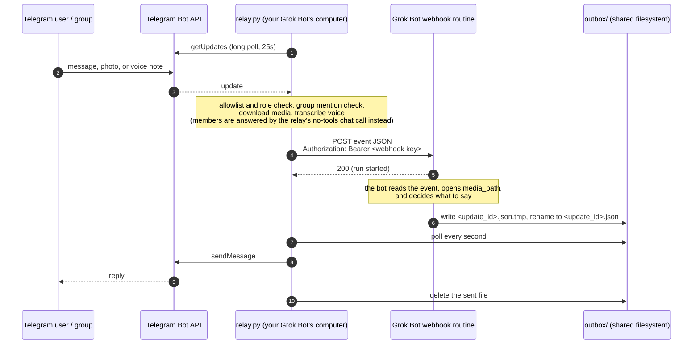

# Setup guide

This is the full setup and operations guide for the [Grok Bot Telegram bridge](../README.md). Start with the README if you just want the short version. The fastest path is to paste the short prompt in [SETUP-PROMPT.md](../SETUP-PROMPT.md) (also at the top of the README) into your existing Grok Bot; that bot creates a dedicated setup bot, and the new bot walks the human through [SETUP-GUIDE.md](SETUP-GUIDE.md) one step at a time. No GitHub account is needed.

A small relay that puts a [Grok Bot](https://cursor.com/help/grok-bot) in Telegram. People
you approve can message the bot in a DM or @mention it in a group, send photos and voice
notes, and get answers back in the same chat.

**Where it runs.** The bridge is meant to run on your Grok Bot's own always-on Linux
computer. Ask your Grok Bot to set it up and start it there. Nothing needs to run on your
laptop or phone, and you don't host this on Vercel, Cloudflare, a VPS, or similar. The
relay only makes outbound connections (it long-polls Telegram and POSTs to your bot's
webhook), so there are no inbound ports, tunnels, or Tailscale.

It is one Python file using only the standard library, plus an optional local speech-to-text
helper for voice notes. There is no database.

> **Status:** early and small. It works well for one household, but it has not been hardened
> for public bots. Read [SECURITY.md](../SECURITY.md) before you connect it to a bot that has
> access to your email, money, or work.

## Why this exists

Grok Bot has no built-in Telegram channel. Families and small teams that used agents like
Hermes Agent or OpenClaw in a shared Telegram group liked how it worked: everyone talks to
the same assistant in the place they already chat. We wanted the same thing for Grok Bot.

Grok Bot routines can be started by a webhook. So a tiny bridge can:

1. read new messages from Telegram,
2. POST each message to a webhook routine on your Grok Bot, and
3. send whatever the bot writes back into Telegram.

That is all this project is. We wrote it from scratch, small enough to read in one sitting,
instead of forking a larger agent framework.

## How it works



- **Inbound:** `relay.py` long-polls Telegram's `getUpdates`. Nothing connects in to your
  machine.
- **Forwarding:** each message from an **admin** becomes one webhook POST, which starts one
  run of your routine. Members' messages are never forwarded; see
  [Roles](#roles-admins-and-members). A 200 only means the run started. The reply comes later.
- **Outbound:** the bot writes a small JSON file into `outbox/`. The relay sends it with
  `sendMessage` and deletes it. That is why the bridge and the bot must share a filesystem
  (see [Limitations](#limitations)).
- **Typing:** as soon as a message is accepted, the relay starts Telegram's "typing..."
  indicator and refreshes it every 4 seconds until the outbox reply is sent or moved to
  `outbox/failed/`, forwarding fails, or `GROKBOT_TYPING_MAX` seconds have passed
  (default 180).

## Quickstart

The usual path is to ask your Grok Bot to run the steps below on its own always-on
Linux computer. You need Python 3.10+ on that machine, and `ffmpeg` if you want voice
notes. The bot and the relay share the same filesystem, which is why they live together.
Nothing needs to run on your laptop or phone.

### 1. Create the Telegram bot

1. In Telegram, open [@BotFather](https://t.me/BotFather), send `/newbot`, and follow the
   prompts. Copy the token. Treat it like a password.
2. For groups, send `/setprivacy` to BotFather, **pick the right bot**, and choose
   **Disable**. Otherwise Telegram may not deliver group messages to the bot.
3. **Remove the bot from the group and add it again.** Telegram applies the privacy change
   only when the bot rejoins. (Making the bot a group admin also works.)

The relay still answers only messages that @mention it or reply to it; privacy mode just
controls what Telegram delivers.

### 2. Create the webhook routine on your Grok Bot

1. On the Grok Bot that should answer, create a routine with a **webhook** trigger. Use the
   prompt in [examples/routine-prompt.md](../examples/routine-prompt.md) as a starting point.
   You can ask the bot to create it for you.
2. Get the webhook URL and key from the **Grok Bot desktop app**: open the bot, then
   **Details → Routines →** your routine, then the **Webhook** section ("POST to", "key", and
   the header). The mobile app shows the routine's instructions but not the URL or key, so
   do this step on a computer.

### 3. Configure

No GitHub account or credentials are needed. Prefer the public zip; an
anonymous `git clone` of the HTTPS URL is also fine. Do not use SSH or a
GitHub token.

```bash
curl -fsSL -o /tmp/grokbot-telegram-bridge.zip \
  https://github.com/Ashe-Oro/grokbot-telegram-bridge/archive/refs/heads/main.zip
unzip -q /tmp/grokbot-telegram-bridge.zip
mv grokbot-telegram-bridge-main grokbot-telegram-bridge
cd grokbot-telegram-bridge
# Or: git clone https://github.com/Ashe-Oro/grokbot-telegram-bridge.git
#      cd grokbot-telegram-bridge
cp .env.example .env
chmod 600 .env
# edit .env: TELEGRAM_BOT_TOKEN, GROKBOT_WEBHOOK_URL, GROKBOT_WEBHOOK_KEY
```

All settings are environment variables. `.env` is a convenience; real environment variables
win over it. See [.env.example](../.env.example) for the full list:

| Variable | Required | Purpose |
|---|---|---|
| `TELEGRAM_BOT_TOKEN` | yes | BotFather token |
| `GROKBOT_WEBHOOK_URL` | to forward | The routine's webhook URL |
| `GROKBOT_WEBHOOK_KEY` | to forward | Sent as `Authorization: Bearer <key>` |
| `GROKBOT_ADMINS` | first admin | Bootstrap new admin user ids (comma separated); existing roles are never changed. The host puts their own id here to become the first admin |
| `GROKBOT_ALLOWLIST` | no | Telegram user ids added as members from the start (comma separated) |
| `GROKBOT_MEMBER_LLM_API_KEY` | for members | API key for the members' chat model. Unset: members get "I'm only set up to chat with admins right now." |
| `GROKBOT_MEMBER_LLM_BASE_URL` | no | OpenAI-compatible base URL (default `https://api.x.ai/v1`) |
| `GROKBOT_MEMBER_LLM_MODEL` | no | Chat model (default `grok-4.3`, text and image input) |
| `GROKBOT_MEMBER_LLM_TIMEOUT` | no | Seconds per member reply (default 60) |
| `GROKBOT_MEMBER_LLM_VISION` | no | `1` (default) sends member photos (JPEG/PNG) to the model; `0` sends only the caption |
| `GROKBOT_BOT_NAME` | no | Name in the "isn't connected yet" reply and the members' chat persona |
| `GROKBOT_DATA_DIR` | no | Where state, outbox, media, and logs live (default: this folder) |
| `GROKBOT_ASR_PYTHON` | no | Python in the faster-whisper venv (default `./.venv-asr/bin/python`) |
| `GROKBOT_ASR_MODEL` | no | `base.en` (default) or e.g. `small` for multilingual |
| `GROKBOT_ASR_TIMEOUT` | no | Seconds per transcription (default 90) |
| `GROKBOT_TYPING_MAX` | no | Seconds to keep refreshing Telegram's "typing..." while a reply is pending (default 180) |
| `GROKBOT_SECRETS_FILE` | no | Path to a 0600 `export NAME=value` file that `start.sh` sources so secrets survive a reboot (default `/workspace/.secrets/grokbot-telegram.env`) |

On the Grok Bot computer, values from a chat secret-request field live only in
the process environment and are wiped when the machine reboots. After each
secret is submitted, write `export NAME=<value>` lines into the secrets file
(mode 0600, directory 0700) with `umask 077` and
`printf 'export NAME=%q\n' "$NAME"` — never cat or echo the file, and do not
source the existing file first (that would overwrite a newly submitted
rotation). Write a temporary file in the same directory and `mv` it over the
destination, dropping the old line for any name you are replacing. Also append
`[ -f FILE ] && . FILE` to `~/.bashrc` so interactive sessions see the
variables. That bashrc hook is not enough by itself: the hourly keep-alive
routine runs non-interactively and does not read `~/.bashrc`, so `start.sh`
loads the file directly, with already-set environment values winning over the
file. Once the file is in place, the keep-alive can bring
the bridge back after a reboot without asking for the keys again. A custom
`GROKBOT_SECRETS_FILE` path must be set in `.env` or in the keep-alive
command, not only in the process environment.

The file is same-UID trusted: any process running as the relay's Unix user can
read it. See [SECURITY.md](../SECURITY.md) and
[SETUP-GUIDE.md](SETUP-GUIDE.md#persist-secrets-across-reboots) for the exact
commands. `.env` is still supported for self-hosting and for non-secret
settings such as `GROKBOT_ADMINS`.

### 4. (Optional) Voice notes

```bash
sudo apt install ffmpeg          # or your distro's equivalent
python3 -m venv .venv-asr
.venv-asr/bin/pip install -r requirements-asr.txt
```

The relay itself never needs pip. See [Photos and voice notes](#photos-and-voice-notes).

### 5. Start

```bash
python3 relay.py --check     # calls getMe; prints the bot's id, username, and privacy setting
./start.sh                   # starts the watchdog in the background; refuses to start without the webhook URL and key
./start.sh --pairing-only    # disables webhook delivery even when URL/key are configured
./ensure.sh                  # start only if not already running (for cron or a keep-alive routine)
./stop.sh
tail -f relay.log            # or $GROKBOT_DATA_DIR/relay.log if you set a data dir
```

Pairing-only mode exports `GROKBOT_PAIRING_ONLY=1` and persists a private data-dir
marker for `ensure.sh` restarts. Run `stop.sh`, then `start.sh` without the flag
(and unset `GROKBOT_PAIRING_ONLY`) to clear it and enable forwarding.

### 6. Pair people

Message the bot from Telegram. If you are not on the allowlist, it replies:

> This bot is private. To request access, ask the owner to approve pairing code: 3FA9C1

Approve on the machine:

```bash
python3 approve.py 3FA9C1                 # approve as member (the default)
python3 approve.py 3FA9C1 --admin         # approve as admin (or: --role admin|member)
python3 approve.py --list                 # users with roles, and pending codes
python3 approve.py --add <id> [--admin]   # add a numeric Telegram user id directly
python3 approve.py --role <id> admin      # change a role (admin|member)
python3 approve.py --remove <id>
```

Or, as an admin, approve from Telegram. Commands go to the bridge itself, not to the
Grok Bot:

- **In a DM** with the bot: `/approve 3FA9C1`
- **In a group:** `/approve@YourBot 3FA9C1`, or reply to one of the bot's messages with
  `/approve 3FA9C1`. A plain `/approve 3FA9C1` in a group (not addressed to the bot) is
  ignored, because the bridge only answers group messages aimed at the bot.

`/approve` always adds the person as a member. Then `/promote <user_id>` or
`/demote <user_id>` if needed. The same addressing rules apply to those commands and to
`/whoami`. Members who try `/approve`, `/promote`, or `/demote` get "Only an admin can
do that." Codes expire after 24 hours. `/whoami` replies with your user id, the chat id,
and your role, which is handy for `GROKBOT_ADMINS` and for proactive messages. Approving
in a DM keeps the pairing code out of the group if you'd rather.

The person who hosts the bot sets the first admin. Put your own Telegram user id in
`GROKBOT_ADMINS` before starting, or start the bridge, message it, and approve your own
code with `python3 approve.py <CODE> --admin`. The first person to message the bot is
**not** made an admin automatically. Until an admin is set, nobody's messages reach the
webhook.

### Roles: admins and members

| | Admin | Member (the default) |
|---|---|---|
| Chat (text, photos, voice notes) and get a reply | yes, via the Grok Bot webhook routine (full agent) | yes, via a plain no-tools chat-completion call made by the relay |
| Tools, connectors, the host computer, files, processes, routines, settings | whatever the bot has | **none** — members can't run tools, search files, start or stop processes, create routines, or change settings |
| Photos | saved; path in the event | sent to the chat model (JPEG/PNG) |
| Voice notes | transcribed locally; transcript in the event | transcribed locally; transcript sent as text |
| `/approve`, `/promote`, `/demote` | yes | "Only an admin can do that." |
| `/whoami` | yes | yes |

New people always join as members. The first admin is set by the person who hosts the bot
(see above), not by the first person who messages it.

Members never reach the webhook or any agent, so nothing they say can make the bot act. The
member chat model gets a system prompt saying it can only chat, a rolling context of the
last 10 turns in that chat (kept in memory only), and the new message prefixed with the
sender's first name. It is told to say kindly that it can't take actions and to suggest
asking an admin. Member messages are sent to the chat model's provider. The relay keeps
showing "typing..." while the member reply is generated, and a timeout or API error gets a
polite "try again" reply. Group rules are the same for both roles.

## The receiving bot's routine

The bot's routine prompt does the real work. The full example, with the event fields and the
outbox contract, is in [examples/routine-prompt.md](../examples/routine-prompt.md). The short
version:

**Event fields** (POST body): `source`, `update_id`, `chat_id`, `chat_type`, `chat_title`,
`message_id`, `user_id`, `username`, `first_name`, `date`, `kind` (`text` / `photo` /
`voice`), `text`, `reply_file`, `media_path`, `transcript`, `role` (always `admin`; members
never reach the webhook), and for media `media_mime`,
`media_size`, plus `media_duration`, `voice_source`, `transcript_error` for voice.

**Reply contract:**

1. Write `{"chat_id": <from event>, "text": "<reply>", "reply_to_message_id": <message_id>}`
   to `<reply_file>.tmp`.
2. Rename it to `<reply_file>` (which is `outbox/<update_id>.json`).

The relay only picks up files ending in `.json` that are at least half a second old, so a
rename is atomic and a half-written reply is never sent. Text over 4096 characters is split
into several messages. A malformed file, or one Telegram rejects with a 4xx, moves to
`outbox/failed/`. On a 429, 5xx, or network error the claimed work file stays and is retried from
the last acknowledged chunk; `retry_after` delays the next attempt. Outbox JSON
and text are capped at 1 MiB; symlinks and non-regular files are rejected.

## Group behavior

- In a group or supergroup, the relay forwards a message only if it **@mentions the bot**
  (in text or a photo caption) or **replies to one of the bot's messages**, and only if the
  sender is approved. Admin messages go to the webhook; member messages go to the no-tools
  chat model. Everything else is ignored and never leaves the machine.
- An unknown person who mentions the bot gets a pairing code in the group.
- DMs from approved users are always answered (admins via the webhook, members via the chat model).
- Admin commands in a group must be aimed at the bot: `/approve@YourBot CODE`, or a
  reply to one of the bot's messages with `/approve CODE`. A plain `/approve CODE` in a
  group is ignored. The same rules apply to `/promote`, `/demote`, and `/whoami`. In a
  DM with the bot, the plain forms work.

## Photos and voice notes

- **Photos** (and images sent as files) are downloaded to `media/<update_id>/media.<ext>`.
  The event has `kind: "photo"`, the caption as `text`, and the absolute `media_path`, so
  the bot can open the image itself.
- **Voice notes**, audio files, and round video notes are downloaded the same way and
  transcribed locally with [faster-whisper](https://github.com/SYSTRAN/faster-whisper)
  (`base.en`, CPU, int8) in a separate venv. The model loads on the first voice note and
  then stays warm in a helper process (`transcriber.py`). On a small CPU box, a short note
  takes about a second once warm. If transcription fails or times out, the message is still
  forwarded with `transcript: null` and the audio path.
- **The ffmpeg workaround:** with some PyAV / faster-whisper versions, passing a file path to
  `transcribe()` fails inside `av.open` with
  `TypeError: ... unexpected keyword argument 'metadata_errors'`. The helper avoids PyAV
  entirely: it decodes with `ffmpeg` to 16 kHz mono float32 and passes a numpy array.
- **Size cap:** the Bot API won't let bots download files over 20 MB. Bigger files are
  refused with a friendly reply and never downloaded.
- **Retention:** cleanup runs once a minute and after worker jobs. Media older than
  7 days is removed, then oldest media is removed until below the 512 MiB quota.
- The bot shows "typing…" while it downloads and transcribes.
- Stickers, video, edits, and other update types are ignored.

## Proactive messages from routines

Any routine on the same bot can post into Telegram by writing a file to `outbox/` with the
same write-then-rename step, for example a Sunday meal-planning reminder to the family
group. The name only needs to end in `.json`. See
[examples/routine-prompt.md](../examples/routine-prompt.md#proactive-messages-from-other-routines).

Taking commands already works: anything an admin says to the bot starts a run,
so "remind us every Sunday to plan meals" is something the bot can set up as its own
scheduled routine. Routines that need a login or an approval will still need you.

## How it runs

- One supervisor process (`supervise.sh`) on your Grok Bot's always-on Linux computer.
  It runs `relay.py` and restarts it after 5 seconds if it exits. A second process for
  transcription starts on the first voice note. Inside the relay, a small loop refreshes
  Telegram's "typing..." every 4 seconds until the reply is sent or
  `GROKBOT_TYPING_MAX` seconds have passed (default 180).
- Outbound HTTPS only (Telegram, the webhook, and the member chat API). No inbound ports,
  no TLS certs, no tunnels, no Tailscale.
- State is `state.json` (update offset, allowlist, roles, pending codes; no secrets), shared with
  `approve.py` through a file lock.
- Logs (`relay.log`) carry update ids, user ids, chat types, kinds, sizes, and errors. They
  never carry tokens, keys, message text, captions, or transcripts.
- `start.sh` launches the supervisor in the background (via `setsid`) and writes its pid
  and Linux start time to `relay.pid` under `GROKBOT_DATA_DIR` (default: this folder). If
  `GROKBOT_SECRETS_FILE` (default `/workspace/.secrets/grokbot-telegram.env`)
  exists, `start.sh` sources it after tightening the data directory, keeping
  any already-set non-empty environment values, and never
  prints the values. `stop.sh` signals the
  whole process group and then any leftover relay child of that supervisor.
- `ensure.sh` is an idempotent health check: if the supervisor is alive it exits 0 and
  prints `ok: running`; otherwise it runs `./start.sh`. It also warns if `ffmpeg` or the
  speech-to-text venv (`GROKBOT_ASR_PYTHON`, default `./.venv-asr/bin/python`) is missing,
  without treating that as a hard failure. On the Grok Bot computer, run it from a
  scheduled Grok Bot routine: that machine's PID 1 is not systemd and often has no cron,
  so the keep-alive routine is the usual way to bring the bridge back after a reboot.
  See [examples/keepalive-routine.md](../examples/keepalive-routine.md).

### Optional: self-host elsewhere with systemd

The intended setup is the bot's own computer, using `start.sh` and the keep-alive routine
above. If you instead run the relay on some other Linux machine that has systemd, you can
use the example unit instead of `start.sh` / `supervise.sh` / `ensure.sh`, not alongside
them. The unit restarts the relay on failure and at boot, so you don't need the watchdog
scripts or the keep-alive routine. This is optional and not required for the usual setup.

```bash
# optional, only if you self-host elsewhere (see examples/grokbot-telegram-bridge.service)
sudo cp examples/grokbot-telegram-bridge.service /etc/systemd/system/
sudoedit /etc/systemd/system/grokbot-telegram-bridge.service   # set User and paths
sudo systemctl daemon-reload
sudo systemctl enable --now grokbot-telegram-bridge
```

## Tests

```bash
python3 test_media.py
python3 test_transcriber.py
python3 test_permissions.py
python3 test_start_secrets.py
```

Offline tests with a fake token: Telegram, file downloads, and the webhook are mocked. They
need `ffmpeg` to generate fixtures. The voice tests also need the faster-whisper venv and
are skipped without it. The role tests mock the chat-model HTTP call and check that member
messages never reach the webhook. `test_start_secrets.py` checks that `start.sh` loads a
temporary 0600 secrets file and warns (without echoing values) if it is group- or
other-readable; it never reads a real secrets path. Every test also checks that no token
or key reached the logs or any file on disk.

## Limitations

- **Latency.** Each message starts a full agent run. Expect a few seconds to a minute per
  reply.
- **Usage.** One admin message is one routine run; one member message is one chat-model
  API call billed to `GROKBOT_MEMBER_LLM_API_KEY`. A chatty group can use a lot of your plan;
  keep an eye on usage.
- **Text replies only.** The bot can't send photos or files back, edit messages, or react.
  Edited messages and reactions from users are ignored.
- **Shared filesystem.** The bot must be able to write to `outbox/` and read `media/` at the
  same absolute paths the relay uses. That's why the intended setup is the bot's own
  always-on computer. Running the relay somewhere else (a VPS, a home server) would need
  another way back, for example a small authenticated HTTPS endpoint on the relay that the
  bot POSTs replies to, or a synced folder. Neither is built, and you don't need it for
  the usual setup.
- Bounded workers and pairing cooldown; paid-call budgets and general per-chat rate limits remain unimplemented. See [SECURITY.md](../SECURITY.md).
- **Single instance.** Run one relay per Telegram bot token. Two pollers on the same token
  will fight over updates.

## Delivery and resource limits

Outbox destinations must already be seen chats or approved user ids. For a first
proactive message to an unseen group, add its chat id to `GROKBOT_OUTBOX_CHATS`
(comma/space separated); unknown destinations move to `outbox/failed/`.

Webhook POSTs include `Idempotency-Key: telegram:<update_id>` and `update_id` in
the body. The receiver MUST durably reject duplicate keys before starting any
tool work, including retries after a lost HTTP acknowledgment. This bridge alone
cannot guarantee exactly-once receiver actions.

Production updates are fsynced to `jobs/<update_id>.json` before the polling
offset advances. Prepared admin events are fsynced to private
`incoming/<update_id>.json` files before delivery. Failed delivery gets a visible Telegram reply
and background retries (at most 10 batches of three attempts, or 24 hours). Final
failures move to `incoming/failed/` with a final notice. The live queue is limited
to 1000 events; a full incoming queue leaves work in jobs/ for retry. Pairing-only pauses queued
delivery. Demoted users' queued events take the member chat path; removed users'
events are discarded before retry.

Production polling durably admits work to `jobs/` before advancing its offset.
`GROKBOT_ADMIN_WORKERS` and `GROKBOT_MEMBER_JOBS` default to 2 each; up to 1000
pending jobs wait on disk. `GROKBOT_VISION_MAX_BYTES` defaults to 4 MiB, with a
text-only fallback above that size. `GROKBOT_MEMBER_HISTORY_CHATS` defaults to 128
(LRU). `GROKBOT_MEDIA_MAX_BYTES` defaults to 512 MiB; cleanup removes oldest media
in addition to the seven-day TTL. Stranger pairing replies have a 60-second cooldown.
Failed jobs and webhook events need operator review and cleanup in their `failed/`
subdirectories. Default `GROKBOT_ASR_TIMEOUT` is 90 seconds (overridable).

## Roadmap ideas

Not built yet. Contributions welcome.

- An opt-in "all messages" group mode (respond without a mention)
- Per-user and per-chat rate limits and a daily run budget
- Sending photos and files back, editing messages, reactions
- A hosted or remote relay that doesn't need a shared filesystem
- Per-chat allowlists (allow a whole group instead of individual users)

## More

- [README](../README.md): short overview, plus the copy-paste setup prompt
- [SETUP-PROMPT.md](../SETUP-PROMPT.md): the same short copy-paste prompt
- [SETUP-GUIDE.md](SETUP-GUIDE.md): numbered walkthrough the dedicated bot follows one step at a time
- [SECURITY.md](../SECURITY.md): threat model and how to report a vulnerability
- [HOW-WE-BUILT-IT.md](HOW-WE-BUILT-IT.md): the build story and the bugs we hit
- [examples/](../examples/): routine prompt, keep-alive routine, and an optional systemd unit for self-hosting elsewhere

## License

MIT. See [LICENSE](../LICENSE).

This is a community project, not an official Grok Bot or Telegram product.
