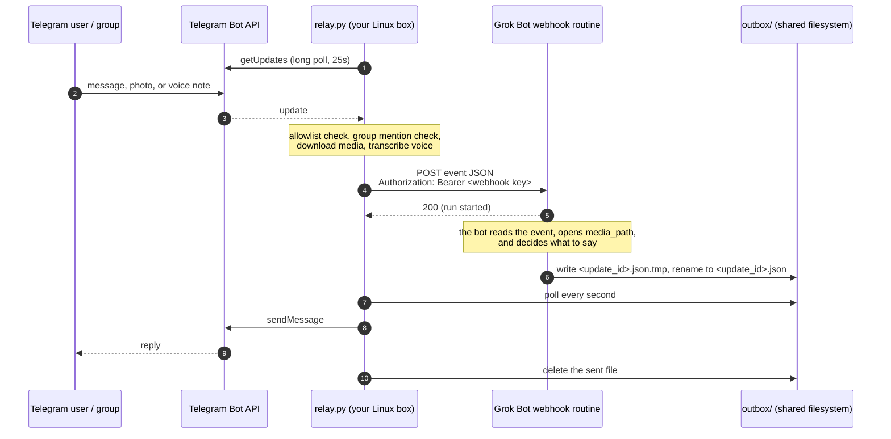

# Setup guide

This is the full setup and operations guide for the [Grok Bot Telegram bridge](../README.md). Start with the README if you just want the short version.

A small, self-hosted relay that puts a [Grok Bot](https://cursor.com/help/grok-bot) in
Telegram. People you approve can message the bot in a DM or @mention it in a group, send
photos and voice notes, and get answers back in the same chat.

It is one Python file using only the standard library, plus an optional local speech-to-text
helper for voice notes. It needs no inbound ports, no public server, and no database.

> **Status:** early and small. It works well for one household, but it has not been hardened
> for public bots. Read [SECURITY.md](../SECURITY.md) before you connect it to a bot that has
> access to your email, money, or work.

## Why this exists

Grok Bot has no built-in Telegram channel. Families and small teams that used agents like
Hermes Agent or OpenClaw in a shared Telegram group liked how it worked: everyone talks to
the same assistant in the place they already chat. We wanted the same thing for Grok Bot.

Grok Bot routines can be started by a webhook. So a tiny bridge can:

1. read new messages from Telegram,
2. POST each message to a webhook routine on your Grok Bot, and
3. send whatever the bot writes back into Telegram.

That is all this project is. We wrote it from scratch, small enough to read in one sitting,
instead of forking a larger agent framework.

## How it works



- **Inbound:** `relay.py` long-polls Telegram's `getUpdates`. Nothing connects in to your
  machine.
- **Forwarding:** each message from an allowlisted user becomes one webhook POST, which
  starts one run of your routine. A 200 only means the run started. The reply comes later.
- **Outbound:** the bot writes a small JSON file into `outbox/`. The relay sends it with
  `sendMessage` and deletes it. That is why the bridge and the bot must share a filesystem
  (see [Limitations](#limitations)).
- **Typing:** as soon as a message is accepted, the relay starts Telegram's "typing..."
  indicator and refreshes it every 4 seconds until the outbox reply is sent or moved to
  `outbox/failed/`, forwarding fails, or `GROKBOT_TYPING_MAX` seconds have passed
  (default 180).

## Quickstart

You need: a persistent Linux machine the Grok Bot can also read and write files on (for
example the bot's own computer), Python 3.10+, and `ffmpeg` if you want voice notes.

### 1. Create the Telegram bot

1. In Telegram, open [@BotFather](https://t.me/BotFather), send `/newbot`, and follow the
   prompts. Copy the token. Treat it like a password.
2. For groups, send `/setprivacy` to BotFather, **pick the right bot**, and choose
   **Disable**. Otherwise Telegram may not deliver group messages to the bot.
3. **Remove the bot from the group and add it again.** Telegram applies the privacy change
   only when the bot rejoins. (Making the bot a group admin also works.)

The relay still answers only messages that @mention it or reply to it; privacy mode just
controls what Telegram delivers.

### 2. Create the webhook routine on your Grok Bot

1. On the Grok Bot that should answer, create a routine with a **webhook** trigger. Use the
   prompt in [examples/routine-prompt.md](../examples/routine-prompt.md) as a starting point.
   You can ask the bot to create it for you.
2. Get the webhook URL and key from the **Grok Bot desktop app**: open the bot, then
   **Details → Routines →** your routine, then the **Webhook** section ("POST to", "key", and
   the header). The mobile app shows the routine's instructions but not the URL or key, so
   do this step on a computer.

### 3. Configure

```bash
git clone <this repo> grokbot-telegram-bridge
cd grokbot-telegram-bridge
cp .env.example .env
chmod 600 .env
# edit .env: TELEGRAM_BOT_TOKEN, GROKBOT_WEBHOOK_URL, GROKBOT_WEBHOOK_KEY
```

All settings are environment variables. `.env` is a convenience; real environment variables
win over it. See [.env.example](../.env.example) for the full list:

| Variable | Required | Purpose |
|---|---|---|
| `TELEGRAM_BOT_TOKEN` | yes | BotFather token |
| `GROKBOT_WEBHOOK_URL` | to forward | The routine's webhook URL |
| `GROKBOT_WEBHOOK_KEY` | to forward | Sent as `Authorization: Bearer <key>` |
| `GROKBOT_ALLOWLIST` | no | Telegram user ids allowed from the start (comma separated) |
| `GROKBOT_BOT_NAME` | no | Name in the "isn't connected yet" reply |
| `GROKBOT_DATA_DIR` | no | Where state, outbox, media, and logs live (default: this folder) |
| `GROKBOT_ASR_PYTHON` | no | Python in the faster-whisper venv (default `./.venv-asr/bin/python`) |
| `GROKBOT_ASR_MODEL` | no | `base.en` (default) or e.g. `small` for multilingual |
| `GROKBOT_ASR_TIMEOUT` | no | Seconds per transcription (default 180) |
| `GROKBOT_TYPING_MAX` | no | Seconds to keep refreshing Telegram's "typing..." while a reply is pending (default 180) |

If your bot has a secrets store, keep the token and key there and export them into the
relay's environment instead of writing them to `.env`.

### 4. (Optional) Voice notes

```bash
sudo apt install ffmpeg          # or your distro's equivalent
python3 -m venv .venv-asr
.venv-asr/bin/pip install -r requirements-asr.txt
```

The relay itself never needs pip. See [Photos and voice notes](#photos-and-voice-notes).

### 5. Start

```bash
python3 relay.py --check     # calls getMe; prints the bot's id, username, and privacy setting
./start.sh                   # starts the watchdog in the background; refuses to start without the webhook URL and key
./start.sh --pairing-only    # runs without a webhook: pairing works, nothing is forwarded
./ensure.sh                  # start only if not already running (for cron or a keep-alive routine)
./stop.sh
tail -f relay.log            # or $GROKBOT_DATA_DIR/relay.log if you set a data dir
```

### 6. Pair people

Message the bot from Telegram. If you are not on the allowlist, it replies:

> This bot is private. To request access, ask the owner to approve pairing code: 3FA9C1

Approve on the machine:

```bash
python3 approve.py 3FA9C1        # adds that Telegram user to the allowlist
python3 approve.py --list        # allowlist and pending codes
python3 approve.py --add <id>    # allow a numeric Telegram user id directly
python3 approve.py --remove <id>
```

Or, once you are allowlisted yourself, send `/approve 3FA9C1` to the bot in Telegram. Codes
expire after 24 hours. `/whoami` replies with your user id and the chat id, which is handy
for `GROKBOT_ALLOWLIST` and for proactive messages.

To bootstrap, either set your own id in `GROKBOT_ALLOWLIST`, or start the bridge, message
the bot, and approve your own code with `approve.py`.

## The receiving bot's routine

The bot's routine prompt does the real work. The full example, with the event fields and the
outbox contract, is in [examples/routine-prompt.md](../examples/routine-prompt.md). The short
version:

**Event fields** (POST body): `source`, `update_id`, `chat_id`, `chat_type`, `chat_title`,
`message_id`, `user_id`, `username`, `first_name`, `date`, `kind` (`text` / `photo` /
`voice`), `text`, `reply_file`, `media_path`, `transcript`, and for media `media_mime`,
`media_size`, plus `media_duration`, `voice_source`, `transcript_error` for voice.

**Reply contract:**

1. Write `{"chat_id": <from event>, "text": "<reply>", "reply_to_message_id": <message_id>}`
   to `<reply_file>.tmp`.
2. Rename it to `<reply_file>` (which is `outbox/<update_id>.json`).

The relay only picks up files ending in `.json` that are at least half a second old, so a
rename is atomic and a half-written reply is never sent. Text over 4096 characters is split
into several messages. A malformed file, or one Telegram rejects with a 4xx, moves to
`outbox/failed/`. On a 429, 5xx, or network error the file stays and is retried.

## Group behavior

- In a group or supergroup, the relay forwards a message only if it **@mentions the bot**
  (in text or a photo caption) or **replies to one of the bot's messages**, and only if the
  sender is allowlisted. Everything else is ignored and never leaves the machine.
- An unknown person who mentions the bot gets a pairing code in the group.
- DMs from allowlisted users are always forwarded.
- Commands addressed as `/approve@YourBot` and `/whoami@YourBot` work in groups.

## Photos and voice notes

- **Photos** (and images sent as files) are downloaded to `media/<update_id>/media.<ext>`.
  The event has `kind: "photo"`, the caption as `text`, and the absolute `media_path`, so
  the bot can open the image itself.
- **Voice notes**, audio files, and round video notes are downloaded the same way and
  transcribed locally with [faster-whisper](https://github.com/SYSTRAN/faster-whisper)
  (`base.en`, CPU, int8) in a separate venv. The model loads on the first voice note and
  then stays warm in a helper process (`transcriber.py`). On a small CPU box, a short note
  takes about a second once warm. If transcription fails or times out, the message is still
  forwarded with `transcript: null` and the audio path.
- **The ffmpeg workaround:** with some PyAV / faster-whisper versions, passing a file path to
  `transcribe()` fails inside `av.open` with
  `TypeError: ... unexpected keyword argument 'metadata_errors'`. The helper avoids PyAV
  entirely: it decodes with `ffmpeg` to 16 kHz mono float32 and passes a numpy array.
- **Size cap:** the Bot API won't let bots download files over 20 MB. Bigger files are
  refused with a friendly reply and never downloaded.
- **Retention:** media folders older than 7 days are deleted at startup and every 6 hours.
- The bot shows "typing…" while it downloads and transcribes.
- Stickers, video, edits, and other update types are ignored.

## Proactive messages from routines

Any routine on the same bot can post into Telegram by writing a file to `outbox/` with the
same write-then-rename step, for example a Sunday meal-planning reminder to the family
group. The name only needs to end in `.json`. See
[examples/routine-prompt.md](../examples/routine-prompt.md#proactive-messages-from-other-routines).

Taking commands already works: anything an allowlisted person says to the bot starts a run,
so "remind us every Sunday to plan meals" is something the bot can set up as its own
scheduled routine. Routines that need a login or an approval will still need you.

## How it runs

- One supervisor process (`supervise.sh`) on a persistent Linux machine. It runs
  `relay.py` and restarts it after 5 seconds if it exits. A second process for
  transcription starts on the first voice note. Inside the relay, a small loop refreshes
  Telegram's "typing..." every 4 seconds until the reply is sent or
  `GROKBOT_TYPING_MAX` seconds have passed (default 180).
- Outbound HTTPS only (Telegram and the webhook). No inbound ports, no TLS certs.
- State is `state.json` (update offset, allowlist, pending codes; no secrets), shared with
  `approve.py` through a file lock.
- Logs (`relay.log`) carry update ids, user ids, chat types, kinds, sizes, and errors. They
  never carry tokens, keys, message text, captions, or transcripts.
- `start.sh` launches the supervisor in the background (via `setsid`) and writes its pid
  to `relay.pid` under `GROKBOT_DATA_DIR` (default: this folder). `stop.sh` signals the
  whole process group and then any leftover relay child of that supervisor.
- `ensure.sh` is an idempotent health check: if the supervisor is alive it exits 0 and
  prints `ok: running`; otherwise it runs `./start.sh`. It also warns if `ffmpeg` or the
  speech-to-text venv (`GROKBOT_ASR_PYTHON`, default `./.venv-asr/bin/python`) is missing,
  without treating that as a hard failure. Run it from cron, a systemd timer, or a
  scheduled Grok Bot routine — useful on hosts (including the Grok Bot box) where PID 1
  is not systemd and cron is not installed. See
  [examples/keepalive-routine.md](../examples/keepalive-routine.md).

On a machine with systemd, use the unit instead of `start.sh` / `supervise.sh` /
`ensure.sh`, not alongside them. The unit restarts the relay on failure and at boot, so
you don't need the watchdog scripts or the keep-alive routine:

```bash
# systemd (see examples/grokbot-telegram-bridge.service)
sudo cp examples/grokbot-telegram-bridge.service /etc/systemd/system/
sudoedit /etc/systemd/system/grokbot-telegram-bridge.service   # set User and paths
sudo systemctl daemon-reload
sudo systemctl enable --now grokbot-telegram-bridge
```

## Tests

```bash
python3 test_media.py
```

Offline tests with a fake token: Telegram, file downloads, and the webhook are mocked. They
need `ffmpeg` to generate fixtures. The voice tests also need the faster-whisper venv and
are skipped without it. Every test also checks that no token or key reached the logs or any
file on disk.

## Limitations

- **Latency.** Each message starts a full agent run. Expect a few seconds to a minute per
  reply.
- **Usage.** One message is one routine run. A chatty group can use a lot of your plan;
  keep an eye on usage.
- **Text replies only.** The bot can't send photos or files back, edit messages, or react.
  Edited messages and reactions from users are ignored.
- **Shared filesystem.** The bot must be able to write to `outbox/` and read `media/` at the
  same absolute paths the relay uses. That's simplest when the relay runs on the bot's own
  persistent computer. If you want the relay elsewhere (a VPS, a home server), you'd need
  another way back, for example a small authenticated HTTPS endpoint on the relay that the
  bot POSTs replies to, or a synced folder. Neither is built yet.
- **No rate limiting.** See [SECURITY.md](../SECURITY.md).
- **Single instance.** Run one relay per Telegram bot token. Two pollers on the same token
  will fight over updates.

## Roadmap ideas

Not built yet. Contributions welcome.

- An opt-in "all messages" group mode (respond without a mention)
- Per-user and per-chat rate limits and a daily run budget
- Sending photos and files back, editing messages, reactions
- A hosted or remote relay that doesn't need a shared filesystem
- Per-chat allowlists (allow a whole group instead of individual users)

## More

- [README](../README.md): short overview and quick start
- [SECURITY.md](../SECURITY.md): threat model and how to report a vulnerability
- [HOW-WE-BUILT-IT.md](HOW-WE-BUILT-IT.md): the build story and the bugs we hit
- [examples/](../examples/): routine prompt, systemd unit, and a keep-alive routine

## License

MIT. See [LICENSE](../LICENSE).

This is a community project, not an official Grok Bot or Telegram product.
